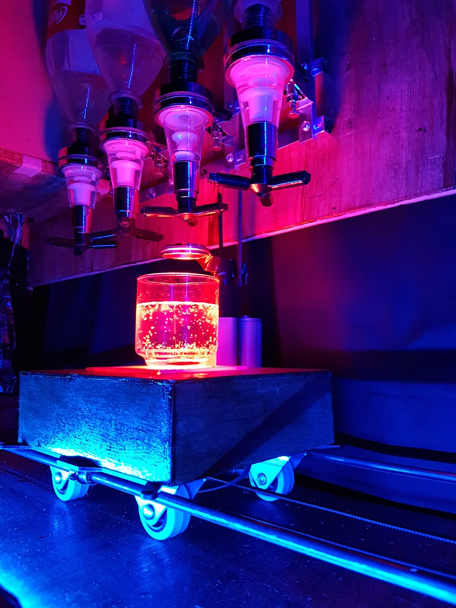
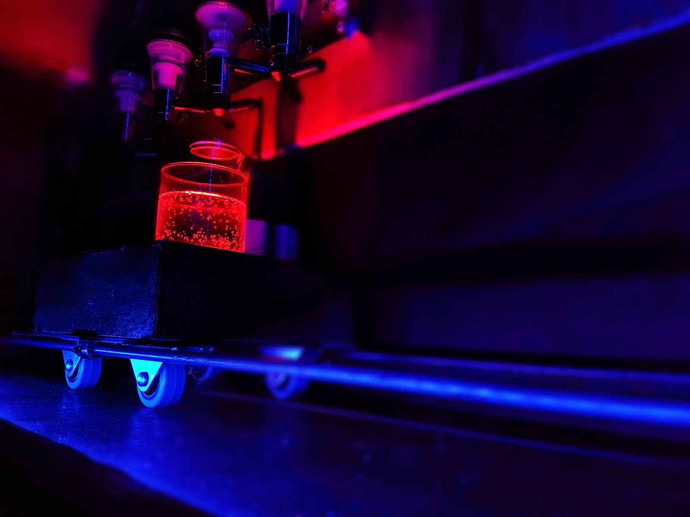
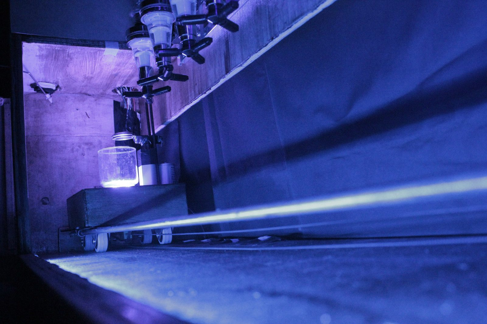

# Máquina de hacer tragos · AVR

Máquina que prepara tragos de forma automática, programada en **C sobre AVR** (ATmega2560 de un Arduino Mega), sin el entorno de Arduino.

Proyecto de la materia **Técnicas Digitales II** · Ingeniería en Electrónica, Universidad Nacional de Moreno · 2017
Autores: **Natalia Gonza** y **Luciano Gutiérrez**

## Cómo funciona

1. El usuario se conecta por **Bluetooth** desde el celular y elige un trago en un menú por terminal serie.
2. Un **motor paso a paso** con correa lleva el carro con el vaso hasta cada botella.
3. **Reed switches** e imanes detienen el carro justo debajo de cada dosificador, sin contar pasos; un **final de carrera** marca el origen.
4. Un **actuador lineal** presiona el dosificador para servir la medida.
5. Un **servo** abre y cierra la puerta para poner y sacar el vaso.
6. Un anillo **NeoPixel** y tiras de LED **RGB** acompañan cada etapa con luz.

## Hardware

| Componente | Uso | Conexión |
|---|---|---|
| Arduino Mega 2560 (ATmega2560, 8 MHz) | Control general, programado en C/AVR con Eclipse | — |
| Módulo Bluetooth HC-05 | Elección del trago desde el celular | UART0 (PE0/PE1), 9600 bps |
| Motor paso a paso NEMA 17 + driver A4988 | Desplazamiento del carro con correa | PORTK 3 (DIR), PORTK 4 (STEP), PORTK 5 (ENABLE) |
| Reed switches (5) y final de carrera | Posición del carro en cada botella | PORTH, PORTE y PORTK 6 |
| Actuador lineal 50 mm + puente H L293D | Accionar los dosificadores | PORTK 0-2 |
| Servomotor | Puerta | PORTB 5 (OC1A), Timer1 en Fast PWM a 50 Hz |
| Anillo NeoPixel WS2812 | Luz de la base del vaso | PORTB 2 (MOSI) |
| Tiras LED RGB 12 V + transistores TIP31 | Iluminación general | PORTF 4-6 |

El detalle de la asignación de puertos, los diagramas y las explicaciones del código están en el [informe técnico](docs/informe-tecnico.pdf).

## Código

| Archivo | Contenido |
|---|---|
| [`src/main.c`](src/main.c) | Programa principal: inicialización, menú por Bluetooth y secuencia de cada uno de los 8 tragos. |
| [`src/qwerty.c`](src/qwerty.c) | Funciones propias: actuador (`SubirActuador`, `ServirTrago1..4`), motor paso a paso (`InitMotor`, `InicializarMotorSensor0..4`, `MotorAvanzar`), servo (`Servo180a45`…) y efectos de luz NeoPixel (`GiroLed…`, `Ascender…`/`Descender…`). |

Algunos detalles técnicos:

- **Servo:** Timer1 de 16 bits en modo Fast PWM invertido, preescaler 8 y `ICR1 = 19999` para obtener 50 Hz; el ángulo se ajusta con `OCR1A`.
- **UART:** `UBRR0L = 51` para 9600 bps con el micro a 8 MHz.
- **Motor paso a paso:** pulsos en el pin STEP del A4988 con retardos en microsegundos para regular la velocidad; el carro busca el sensor de cada posición en lugar de contar pasos.

### Estado del código

El código se recuperó de la versión impresa en el informe (última edición: 4 de noviembre de 2017), por eso puede tener diferencias menores de formato. **No se conservan** algunos archivos necesarios para compilarlo:

- `qwerty.h`: las macros de puertos (`PISTON_UP`, `PAP_PASOS_ON`, `LED_TRAGO1_ON`, etc.).
- `uart0.c` / `uart0.h`: la biblioteca de UART de la materia.
- `light_ws2812.c` / `.h` y `ws2812_config.h`: la biblioteca externa [light_ws2812](https://github.com/cpldcpu/light_ws2812) para controlar los NeoPixel.

Se publica como registro del proyecto y muestra de programación de microcontroladores a nivel de registros.

## Fotos

| | |
|---|---|
|  |  |

Video: https://www.youtube.com/watch?v=uHyXUMsP3EQ

---

Más proyectos de Natalia Gonza en su portafolio: **https://nataliagonzaing-cloud.github.io**
